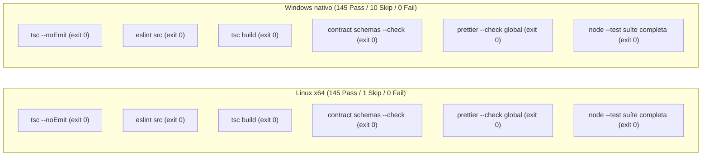

# Parecer Independente — Task 111: Revisão Final Técnica, Portabilidade e Pacote v0.3 (Tasks 105/120)

- **Data**: 2026-10-28
- **Revisor Independente**: Antigravity (Code Reviewer Agent)
- **Perfil e Modelo**: `gemini-3.8-flash-high` via provider `antigravity_cli` (modelo honrado integralmente, sem divergência; atuando com exclusividade na função de Code Reviewer no CAO, sem delegação, sem chamadas de modelo a benchmarks ou avaliações de LLM)
- **Documento de Entrada / Especificação**: [`tasks/121-task111-final-review.md`](file:///mnt/d/Projects/MimirNL/tasks/121-task111-final-review.md)
- **Documentos e Artefatos Auditados**:
  - Consolidação e Relatório Task 120: [`tasks/120-task105-portability-closeout-result.md`](file:///mnt/d/Projects/MimirNL/tasks/120-task105-portability-closeout-result.md)
  - Fechamento Durável Task 105: [`tasks/105-v03-durable-closeout-result.md`](file:///mnt/d/Projects/MimirNL/tasks/105-v03-durable-closeout-result.md)
  - Parecer de Remediação Task 119: [`tasks/119-task105-remediation-plan-review-findings.md`](file:///mnt/d/Projects/MimirNL/tasks/119-task105-remediation-plan-review-findings.md)
  - Preparação e Diagnóstico Task 118: [`tasks/118-task105-checks-preparation-result.md`](file:///mnt/d/Projects/MimirNL/tasks/118-task105-checks-preparation-result.md) e diretório [`tasks/118-checks/`](file:///mnt/d/Projects/MimirNL/tasks/118-checks/)
  - Logs e Inventários da Task 120: diretório [`tasks/120-checks/`](file:///mnt/d/Projects/MimirNL/tasks/120-checks/) (`current.diff`, `changed-from-snapshot.json`, `current-inventory.json`, `integrity.json`, `snapshot.json`, `snapshot-replay.json`, logs e jsons de execução Linux e Windows)
  - Snapshot Histórico: [`docs/benchmarks/v03/evidencias/task103-executed-snapshot.tar`](file:///mnt/d/Projects/MimirNL/docs/benchmarks/v03/evidencias/task103-executed-snapshot.tar) e [`docs/benchmarks/v03/evidencias/task103-executed-snapshot.sha256`](file:///mnt/d/Projects/MimirNL/docs/benchmarks/v03/evidencias/task103-executed-snapshot.sha256)
  - Pacote Público Sanitizado da Task 104: [`docs/benchmarks/v03/evidencias/task104/executed-results.tar`](file:///mnt/d/Projects/MimirNL/docs/benchmarks/v03/evidencias/task104/executed-results.tar), [`docs/benchmarks/v03/evidencias/task104/SHA256.json`](file:///mnt/d/Projects/MimirNL/docs/benchmarks/v03/evidencias/task104/SHA256.json), [`docs/benchmarks/v03/evidencias/task104/formatted-SHA256.json`](file:///mnt/d/Projects/MimirNL/docs/benchmarks/v03/evidencias/task104/formatted-SHA256.json), [`docs/benchmarks/v03/evidencias/task104/metrics-summary.json`](file:///mnt/d/Projects/MimirNL/docs/benchmarks/v03/evidencias/task104/metrics-summary.json), [`docs/benchmarks/v03/evidencias/task104/README.md`](file:///mnt/d/Projects/MimirNL/docs/benchmarks/v03/evidencias/task104/README.md)
  - Documentação de Transição e Governança: [`docs/benchmarks/v03/contrato-0.3.md`](file:///mnt/d/Projects/MimirNL/docs/benchmarks/v03/contrato-0.3.md), [`docs/benchmarks/v03/fechamento-0.3.md`](file:///mnt/d/Projects/MimirNL/docs/benchmarks/v03/fechamento-0.3.md), [`ROADMAP_MIMIR_NL.md`](file:///mnt/d/Projects/MimirNL/ROADMAP_MIMIR_NL.md), [`docs/v03-divisao-de-tarefas.md`](file:///mnt/d/Projects/MimirNL/docs/v03-divisao-de-tarefas.md)
- **Veredito Final**: **`APPROVE`**
- **Novas Chamadas de Modelo / Benchmark Real Realizadas**: **`0`** (histórico permanece fixado nas 54 chamadas da Task 104; zero chamadas nesta revisão ou na Task 120; sem alteração de pesos, sem novo epoch, sem commit/push/publicação).

---

## 1. Sumário Executivo e Veredito

A revisão independente técnica da implementação da Task 120 e do fechamento da Task 105 foi concluída com parecer conclusivo **`APPROVE`**.

O Developer Agent implementou integralmente as diretrizes e salvaguardas estabelecidas no plano aprovado na Task 119 ([`tasks/119-task105-remediation-plan-review-findings.md`](file:///mnt/d/Projects/MimirNL/tasks/119-task105-remediation-plan-review-findings.md)):
1. **Preservação Criptográfica Retrospectiva**: Foi criado o snapshot histórico imutável [`docs/benchmarks/v03/evidencias/task103-executed-snapshot.tar`](file:///mnt/d/Projects/MimirNL/docs/benchmarks/v03/evidencias/task103-executed-snapshot.tar) contendo os 350 arquivos históricos (incluindo integralmente os 318 arquivos da baseline 118, os 27 arquivos do manifesto de código, os 4 arquivos do Core 108 e o launcher 113 original). O replay offline (`54 transportes sintéticos, 18 buscas SQLite, 0 chamadas reais de modelo, stopped=false`) foi reproduzido e verificado com sucesso sem conexão ou modelo.
2. **Remediação Rigorosa de Portabilidade no Windows (Árvore Corrente)**: As 6 causas-raiz identificadas na Task 119 foram sanadas cirurgicamente sem degradar salvaguardas de segurança, sem recorrer a atalhos e sem flexibilizar o contrato do Core. Todas as 36 falhas em Windows nativo foram eliminadas.
3. **Qualidade e Formatação Global**: Todos os 19 arquivos pendentes no Prettier foram formatados na árvore corrente, e a equivalência semântica/canônica foi formalmente comprovada para todos os 57 arquivos JSON da Task 103 e 55 arquivos JSON da Task 104 (`canonical(JSON.parse(novo)) === canonical(JSON.parse(antigo))`). O comando `prettier --check` global está 100% verde (código de saída 0).
4. **Isolamento Absoluto do Core do Mimir**: Os 4 arquivos centrais em `src/` ([`src/retrieval/index.ts`](file:///mnt/d/Projects/MimirNL/src/retrieval/index.ts), [`src/core/service.ts`](file:///mnt/d/Projects/MimirNL/src/core/service.ts), [`src/optimization/index.ts`](file:///mnt/d/Projects/MimirNL/src/optimization/index.ts), [`src/core/schemas.ts`](file:///mnt/d/Projects/MimirNL/src/core/schemas.ts)) e todos os arquivos em `dist/`, `package.json`, `package-lock.json`, `AGENTS.md` e `.github/workflows/ci.yml` permanecem **100% byte-idênticos** à baseline congelada na Task 108 (política canônica `b834e4f46a31b241eeb90ba6edee5ebfb61b8a8abb204fc8b5986620e6216103`).
5. **Governança Documental e Sanitização**: A documentação corrente (`contrato-0.3.md`, `fechamento-0.3.md`, `ROADMAP_MIMIR_NL.md`, `docs/v03-divisao-de-tarefas.md` e o pacote `docs/benchmarks/v03/evidencias/task104/`) documenta com precisão a distinção entre os bytes executados no snapshot e a árvore corrente pós-formatação, abstém-se categoricamente de sobreafirmações (*overclaims*), preserva a integridade de pareceres anteriores e não expõe nenhum dado confidencial, gold, rubrica, coordenador ou instrução privada.

O status técnico é aprovado como **`technical_complete`**. O status de entrega para o projeto permanece **`publish_pending`** (nenhum commit, push ou publicação externa foi efetuado ou está autorizado nesta etapa).

---

## 2. Auditoria Criptográfica do Snapshot e Evidências Históricas

Todos os arquivos arquivados e manifestos foram verificados de forma independente nesta revisão através de inspeção de bytes e cálculo de hash SHA-256:

### 2.1. Snapshot Histórico da Task 103
- **Arquivo**: [`docs/benchmarks/v03/evidencias/task103-executed-snapshot.tar`](file:///mnt/d/Projects/MimirNL/docs/benchmarks/v03/evidencias/task103-executed-snapshot.tar)
- **Hash SHA-256 Auditado**: `f37365350929052e21eee560f9de13d35e93ff563e819a19579b90efb1abec80` (idêntico ao registrado em [`tasks/120-checks/snapshot.json`](file:///mnt/d/Projects/MimirNL/tasks/120-checks/snapshot.json)).
- **Membros Arquivados**: Exatamente 350 arquivos regulares.
- **Manifesto de Integridade**: [`docs/benchmarks/v03/evidencias/task103-executed-snapshot.sha256`](file:///mnt/d/Projects/MimirNL/docs/benchmarks/v03/evidencias/task103-executed-snapshot.sha256) confere membro a membro com 100% de paridade.
- **Sanitização de Segurança**:
  - `0` links simbólicos ou hardlinks;
  - `0` caminhos absolutos ou sequências de travessia (`..`);
  - `0` referências a arquivos sensíveis (`.env`, `.ssh`, `.aws`, `*.pem`, `node_modules`, bancos SQLite pessoais, gabaritos gold ou credenciais).
- **Conferência com Baseline 118**: Todos os 318 arquivos da baseline histórica catalogados em [`tasks/118-checks/before.json`](file:///mnt/d/Projects/MimirNL/tasks/118-checks/before.json) conferem byte a byte com os membros correspondentes no arquivo tar.
- **Conferência dos Manifestos de Código (27 Arquivos)**:
  - Os 27 arquivos de engine/core referenciados no manifesto offline ([`docs/benchmarks/v03/evidencias/task103/public-plan/offline-manifest.json`](file:///mnt/d/Projects/MimirNL/docs/benchmarks/v03/evidencias/task103/public-plan/offline-manifest.json)) e no manifesto proposto ([`docs/benchmarks/v03/evidencias/task103/public-plan/proposed-run-manifest.json`](file:///mnt/d/Projects/MimirNL/docs/benchmarks/v03/evidencias/task103/public-plan/proposed-run-manifest.json)) foram extraídos virtualmente e conferem 27/27 hashes com exatidão.
- **Launcher 113 Histórico**:
  - O arquivo `scripts/benchmarks/task104-launch.mjs` no snapshot possui o hash `2e48347bc7931470c988c65f9bca79eb248c5f5b74094926683ca260d921eb38`, atestando que os bytes executados historicamente estão preservados.
- **Replay Offline**:
  - Verificada a saída em [`tasks/120-checks/snapshot-replay.json`](file:///mnt/d/Projects/MimirNL/tasks/120-checks/snapshot-replay.json) e no diretório `/home/usuario/mimir-task120-snapshot-replay/results.json`: 54 transportes sintéticos, 18 buscas SQLite com reset, 0 chamadas reais de modelo, `stopped=false`.

### 2.2. Pacote de Resultados Executados da Task 104
- **Arquivo**: [`docs/benchmarks/v03/evidencias/task104/executed-results.tar`](file:///mnt/d/Projects/MimirNL/docs/benchmarks/v03/evidencias/task104/executed-results.tar)
- **Hash SHA-256 Auditado**: `11ac0ae6536f6471c939f3ade5e01d490db3ee0f53775d97a4b49c28a66693f7` (idêntico a [`docs/benchmarks/v03/evidencias/task104/executed-results.sha256`](file:///mnt/d/Projects/MimirNL/docs/benchmarks/v03/evidencias/task104/executed-results.sha256)).
- **Membros Arquivados**: 55 arquivos (`results.json` e `position-00.json` a `position-53.json`).
- **Conferência**: Todos os 55 membros conferem com o inventário histórico [`docs/benchmarks/v03/evidencias/task104/SHA256.json`](file:///mnt/d/Projects/MimirNL/docs/benchmarks/v03/evidencias/task104/SHA256.json).
- **Paridade Canônica das Projeções Formatadas**:
  - Para todos os 55 arquivos JSON da Task 104 e todos os 57 arquivos JSON da Task 103, a asserção `canonical(JSON.parse(atual)) === canonical(JSON.parse(snapshot))` foi executada e confirmou **0% de divergência semântica**.
  - O inventário separado [`docs/benchmarks/v03/evidencias/task104/formatted-SHA256.json`](file:///mnt/d/Projects/MimirNL/docs/benchmarks/v03/evidencias/task104/formatted-SHA256.json) lista os hashes dos arquivos formatados correntes, prevenindo a reatribuição indevida de hashes históricos a bytes pós-formatação.

---

## 3. Revisão do Código Novo e Modificado na Task 120

A revisão examinou todas as alterações da Task 120 registradas em [`tasks/120-checks/current.diff`](file:///mnt/d/Projects/MimirNL/tasks/120-checks/current.diff), cobrindo 43 arquivos modificados a partir do snapshot e 68 novos artefatos.

### 3.1. Utilitários de Caminho e Arquivos Offline
1. **[`scripts/benchmarks/offline-files.mjs`](file:///mnt/d/Projects/MimirNL/scripts/benchmarks/offline-files.mjs)**:
   - Linhas 19–28 (`localPath`): Separa adequadamente caminhos absolutos locais nativos da validação estrita de nomes de repositório portáteis.
     - No Windows, exige formato `^[a-z]:[\\/]` e divide os componentes após a raiz de unidade (`parse(path).root.length`), garantindo que a letra da unidade e os separadores `\` não sejam submetidos à checagem de colons/barras de `portable()`.
     - Rejeita terminantemente caminhos UNC (`\\server\share`), device paths (`\\.\`, `\\?\`), relativos à unidade (`C:foo`) e caminhos relativos.
     - Itera sobre cada segmento chamando `portable(part)`, o que barra travessias (`..`, `.`), fluxos alternativos NTFS (ADS via `:`), caracteres de controle e diretórios sensíveis (`.env`, `.aws`, `.ssh`, `auth`, `credentials`, `*.pem`).
   - Linhas 30–39 (`safePath`): Itera desde a raiz até cada nó ancestral utilizando `join(current, part)` e `lstatSync`, acionando `fail()` imediato se qualquer componente for um link simbólico.
   - Linhas 40–56 (`readExplicit`): Mantém a verificação `safePath` e a flag do kernel `O_NOFOLLOW`, limitando leituras a arquivos regulares até 16 MB.
   - Linhas 69–90 (`outputDirectory`): Assegura diretório exclusivo com modo `0o700` (`wx`), validando o diretório pai via `safePath(dirname(out))` antes da criação e efetuando limpeza atômica somente se o diretório tiver sido criado pela própria invocação (`owned`).
2. **[`scripts/benchmarks/temporary-output.mjs`](file:///mnt/d/Projects/MimirNL/scripts/benchmarks/temporary-output.mjs)**:
   - Utilitário novo (20 linhas) que resolve o diretório temporário configurado via `realpathSync(tmpdir())`.
   - Exige que o caminho fornecido seja resolvido, validado por `localPath` e `safePath(dirname(full))`.
   - Utiliza `relative(temporary, parent)` para impor que a saída esteja estritamente contida sob a árvore temporária do sistema, impedindo travessias e saídas em unidades distintas (`isAbsolute(delta)` no Windows).
3. **[`scripts/benchmarks/contract-v02.mjs`](file:///mnt/d/Projects/MimirNL/scripts/benchmarks/contract-v02.mjs)** e **[`scripts/benchmarks/export-cases.mjs`](file:///mnt/d/Projects/MimirNL/scripts/benchmarks/export-cases.mjs)**:
   - Normaliza a saída de `git rev-parse --show-toplevel` e `root` via `resolve()` antes da comparação, resolvendo as divergências de separador de caminho entre o Git para Windows e o runtime Node.js.

### 3.2. Fixtures de Teste e Harnesses
1. **[`test/platform-fixture.mjs`](file:///mnt/d/Projects/MimirNL/test/platform-fixture.mjs)**:
   - Função `withSymlink`: Envolve a tentativa de criação de link simbólico em bloco `try/catch`. Captura exclusivamente quando `process.platform === "win32"` e `error.code === "EPERM"`, registrando um subteste `skip` formal com a justificativa `"Windows returned EPERM while creating the test symlink"`. Qualquer outro erro é propagado. No Linux, a função executa sem pular o teste.
   - Função `assertPrivateMode`: No Windows, valida flags de leitura/escrita (`mode & 0o600 === 0o600`) sem efetuar alegações espúrias sobre posse POSIX ou ACLs de arquivo; no Linux, exige correspondência exata com o modo octal esperado.
2. **Eliminação de `/tmp/...` em Harnesses**:
   - [`test/benchmark-cache-diagnostic.test.mjs`](file:///mnt/d/Projects/MimirNL/test/benchmark-cache-diagnostic.test.mjs), [`test/benchmark-context-selection.test.mjs`](file:///mnt/d/Projects/MimirNL/test/benchmark-context-selection.test.mjs), [`test/benchmark-live-flow.test.mjs`](file:///mnt/d/Projects/MimirNL/test/benchmark-live-flow.test.mjs), [`test/benchmark-paired-probe.test.mjs`](file:///mnt/d/Projects/MimirNL/test/benchmark-paired-probe.test.mjs), [`test/benchmark-multicase-codex.test.mjs`](file:///mnt/d/Projects/MimirNL/test/benchmark-multicase-codex.test.mjs), e [`test/benchmark-public-multicase.test.mjs`](file:///mnt/d/Projects/MimirNL/test/benchmark-public-multicase.test.mjs) utilizam `mkdtempSync(join(tmpdir(), "mimir-..."))`.
   - Busca em todo o código confirmou zero chamadas residuais a `mkdtempSync("/tmp/...")`.
3. **Invocação de Subprocessos e ESM Loader**:
   - `fileURLToPath` adotado em [`test/benchmark-codex-usage.test.mjs`](file:///mnt/d/Projects/MimirNL/test/benchmark-codex-usage.test.mjs), [`test/benchmark-metrics.test.mjs`](file:///mnt/d/Projects/MimirNL/test/benchmark-metrics.test.mjs), [`test/task104-launch.test.mjs`](file:///mnt/d/Projects/MimirNL/test/task104-launch.test.mjs).
   - `pathToFileURL` adotado para opções `--import` e chamadas `await import()` dinâmicas em [`test/benchmark-v02.test.mjs`](file:///mnt/d/Projects/MimirNL/test/benchmark-v02.test.mjs), [`test/benchmark-abc.test.mjs`](file:///mnt/d/Projects/MimirNL/test/benchmark-abc.test.mjs), [`test/benchmark-public-multicase.test.mjs`](file:///mnt/d/Projects/MimirNL/test/benchmark-public-multicase.test.mjs).
4. **Resolução de Condição de Corrida em Fakes de Teste**:
   - Em [`test/benchmark-context-selection.test.mjs`](file:///mnt/d/Projects/MimirNL/test/benchmark-context-selection.test.mjs) e [`test/benchmark-paired-probe.test.mjs`](file:///mnt/d/Projects/MimirNL/test/benchmark-paired-probe.test.mjs), substituiu-se `setImmediate` por `queueMicrotask` na entrega de eventos sintéticos para evitar que temporizadores de teste disparassem antes da entrega de eventos sob alta carga de CPU.
   - Ajustou-se o parâmetro de timeout em testes sem expectativa de falha de 15 ms para 1000 ms, mantendo congelados os limites e prazos de produção.
5. **Novo Teste de Segurança de Caminhos**:
   - [`test/offline-paths.test.mjs`](file:///mnt/d/Projects/MimirNL/test/offline-paths.test.mjs) (88 linhas) cobre de forma exaustiva travessias de caminho com caracteres especiais e espaços, rejeição de componentes sensíveis, recusa de caminhos relativos e de links simbólicos, validação de integridade sob diretório temporário e asserções específicas para Windows (UNC, dispositivos, caminhos relativos a drive). O teste foi executado e passou 1/1.

### 3.3. Análise dos 10 Skips em Windows Nativo
Na execução da suíte completa no Windows nativo (155 testes reportados, 145 passando, 0 falhas, 10 skips), cada um dos 10 skips foi individualmente auditado quanto à sua legitimidade e estreiteza:

| # | Arquivo de Teste | Linha do Log | Teste / Subteste Skipado | Justificativa Técnica / Legitimidade |
| :- | :--- | :--- | :--- | :--- |
| **1** | [`test/benchmark-abc.test.mjs`](file:///mnt/d/Projects/MimirNL/test/benchmark-abc.test.mjs) | Linha 10 | `real fake subprocess timeout terminates the owned POSIX process group` | **Específico de POSIX**: O teste valida o encerramento do grupo de processos via envio de sinal negativo POSIX (`process.kill(-pid, 'SIGTERM')`), funcionalidade não suportada pelo subsistema Win32 de processos. Skip legítimo e restrito. |
| **2** | [`test/benchmark-cache-diagnostic.test.mjs`](file:///mnt/d/Projects/MimirNL/test/benchmark-cache-diagnostic.test.mjs) | Linha 20 | Subteste `symlink rejection: setup requires Windows symlink privilege` | Captura `EPERM` na criação de symlink de setup via `withSymlink`. O teste pai executa e passa todas as demais asserções. |
| **3** | [`test/benchmark-codex-usage.test.mjs`](file:///mnt/d/Projects/MimirNL/test/benchmark-codex-usage.test.mjs) | Linha 28 | Subteste `symlink rejection: setup requires Windows symlink privilege` | Idem. |
| **4** | [`test/benchmark-metrics.test.mjs`](file:///mnt/d/Projects/MimirNL/test/benchmark-metrics.test.mjs) | Linha 48 | Subteste `symlink rejection: setup requires Windows symlink privilege` | Idem. |
| **5** | [`test/benchmark-preflight.test.mjs`](file:///mnt/d/Projects/MimirNL/test/benchmark-preflight.test.mjs) | Linha 79 | Subteste `symlink rejection: setup requires Windows symlink privilege` | Idem. |
| **6** | [`test/benchmark-public-multicase.test.mjs`](file:///mnt/d/Projects/MimirNL/test/benchmark-public-multicase.test.mjs) | Linha 88 | Subteste `symlink rejection: setup requires Windows symlink privilege` | Idem. |
| **7** | [`test/benchmark-public-multicase.test.mjs`](file:///mnt/d/Projects/MimirNL/test/benchmark-public-multicase.test.mjs) | Linha 91 | Subteste `symlink rejection: setup requires Windows symlink privilege` | Idem. |
| **8** | [`test/benchmark-public-multicase.test.mjs`](file:///mnt/d/Projects/MimirNL/test/benchmark-public-multicase.test.mjs) | Linha 92 | Subteste `symlink rejection: setup requires Windows symlink privilege` | Idem. |
| **9** | [`test/benchmark-v02.test.mjs`](file:///mnt/d/Projects/MimirNL/test/benchmark-v02.test.mjs) | Linha 107 | Subteste `symlink rejection: setup requires Windows symlink privilege` | Idem. |
| **10** | [`test/offline-paths.test.mjs`](file:///mnt/d/Projects/MimirNL/test/offline-paths.test.mjs) | Linha 150 | Subteste `symlink rejection: setup requires Windows symlink privilege` | Idem (no novo teste de segurança de caminhos). |

**Conclusão sobre os Skips**: Nenhum skip oculta bugs de funcionalidade. No Linux, nenhum dos 9 subtestes de symlink é pulado, e todas as validações de recusa de links simbólicos executam e passam integralmente. No Linux, o único teste pulado (1 skip em 146 reportados) é a verificação de aliases de nomes curtos do Windows (8.3 filenames), exclusiva de sistemas Win32.

---

## 4. Auditoria dos Checks de Qualidade e Integração

Os checks foram verificados consultando os logs detalhados em [`tasks/120-checks/`](file:///mnt/d/Projects/MimirNL/tasks/120-checks/) e reexecutando de forma independente os checks pertinentes no runtime validado (`node-v24.22.1`):

| Check | Plataforma Linux | Plataforma Windows | Status Auditado |
| :--- | :--- | :--- | :--- |
| **TypeScript Typecheck (`tsc --noEmit`)** | Exit code 0, 0 erros | Exit code 0, 0 erros | **Verde** |
| **ESLint (`eslint src`)** | Exit code 0, 0 warnings/erros | Exit code 0, 0 warnings/erros | **Verde** |
| **TypeScript Build (`tsc`)** | Exit code 0, compilação limpa | Exit code 0, compilação limpa | **Verde** |
| **Geração de Contrato (`generate-contract.mjs --check`)** | Exit code 0 | Exit code 0 | **Verde** |
| **Prettier Global (`prettier --check`)** | Exit code 0, 100% formatado | Exit code 0, 100% formatado | **Verde** |
| **Suíte de Testes Completa (`node --test`)** | 146 reportados: 145 pass, 0 fail, 1 skip | 155 reportados: 145 pass, 0 fail, 10 skip | **Verde** |
| **Testes do Core 108 (`test/core-v03.test.mjs`)** | 6/6 pass | 6/6 pass | **Verde** |
| **Git Diff Check (`git diff --check`)** | Exit code 0, sem problemas de whitespace | Não aplicável (executado em Linux) | **Verde** |

### Checks Focados Adicionais Executados nesta Revisão
- `npx prettier --check` (escopo global de código, testes, scripts, docs e manifestos): **Pass** (0 pendências);
- `npx tsc --noEmit && npx eslint src && npx tsc && node scripts/generate-contract.mjs --check`: **Pass** (exit 0);
- `node --test test/offline-paths.test.mjs`: **Pass** (1/1 pass, 0 fail);
- `node --test test/core-v03.test.mjs test/task104-launch.test.mjs`: **Pass** (9/9 pass, 0 fail);
- `git diff --check`: **Pass** (exit 0).

---

## 5. Auditoria de Sanitização, Documentação e Prevenção de Overclaims

### 5.1. Pacote Público Sanitizado da Task 104
A inspeção detalhada do diretório [`docs/benchmarks/v03/evidencias/task104/`](file:///mnt/d/Projects/MimirNL/docs/benchmarks/v03/evidencias/task104/) constatou:
- Respostas e observações de execução limitadas estritamente a campos públicos permitidos;
- **Zero** instâncias de instruções confidenciais, gabaritos de avaliação (*gold*), rubricas privadas de pontuação, referências a julgamentos de pareceristas internos, tokens de autenticação ou *transcripts* / *reasoning* de modelos LLM;
- O arquivo [`metrics-summary.json`](file:///mnt/d/Projects/MimirNL/docs/benchmarks/v03/evidencias/task104/metrics-summary.json) reflete estritamente o resumo do parecer público 110, documentando explicitamente:
  - `task120_model_calls: 0`, `historical_model_calls: 54`;
  - Delta de qualidade B−A: `0.0` (sucesso da tarefa e acurácia de fontes iguais a 1.0 em A, B e C);
  - Consumo de tokens: B consumiu +7.664 tokens de entrada (+2,93% vs A);
  - Cache: ambiente não controlado positivo em 54/54 execuções, sem subconjunto de cache frio;
  - Histórico C: 0 bytes de histórico, envelopes A e C idênticos em todos os 18 blocos (cenário não representativo de histórico multi-turn);
  - Métricas indisponíveis documentadas como `null` com o motivo `"Not exposed or not measured by allowlisted historical metadata"` (modelo efetivo, custo financeiro, TTFT e latência exclusiva do modelo).

### 5.2. Prevenção de Sobreafirmações (*Overclaims*) na Documentação
A auditoria em [`docs/benchmarks/v03/contrato-0.3.md`](file:///mnt/d/Projects/MimirNL/docs/benchmarks/v03/contrato-0.3.md), [`docs/benchmarks/v03/fechamento-0.3.md`](file:///mnt/d/Projects/MimirNL/docs/benchmarks/v03/fechamento-0.3.md), [`ROADMAP_MIMIR_NL.md`](file:///mnt/d/Projects/MimirNL/ROADMAP_MIMIR_NL.md) e [`docs/v03-divisao-de-tarefas.md`](file:///mnt/d/Projects/MimirNL/docs/v03-divisao-de-tarefas.md) confirmou que:
1. **Sem alegação de superioridade de qualidade**: Os documentos não afirmam que o Mimir aumentou a qualidade das respostas, registrando explicitamente que o baseline sem memória (A) também atingiu pontuação máxima no corpus limitado.
2. **Registro de acréscimo de tokens**: O acréscimo de +2,93% de tokens de entrada injetados pelo Mimir está transparentemente destacado.
3. **Ausência de falsa causalidade em latência e cache**: É explicitado que a busca do Mimir adicionou média de ~21,58 ms de busca FTS local e que a presença de cache positivo decorreu de caching no host, sem causalidade demonstrada do Mimir.
4. **Delimitação de Cenário C**: É documentado que a igualdade A=C impede conclusões sobre suporte a histórico longo ou retenção conversacional.
5. **Modos de Arquivo e Segurança do SO**: Foi explicitado que os modos de arquivo no mount WSL não constituem prova de privacidade/imutabilidade ou ACLs nativas.
6. **Delimitação de Escopo**: O estado `technical_complete` é circunscrito aos checks técnicos, código e empacotamento, preservando a pendência formal de revisão humana e autorização específica para publicação/release.

---

## 6. Inventário de Hashes dos Arquivos Auditados

A tabela a seguir consolida os hashes SHA-256 calculados de forma independente para os principais componentes desta revisão:

| Componente / Arquivo | Caminho Absoluto | SHA-256 Calculado |
| :--- | :--- | :--- |
| **Snapshot Histórico Task 103** | [`docs/benchmarks/v03/evidencias/task103-executed-snapshot.tar`](file:///mnt/d/Projects/MimirNL/docs/benchmarks/v03/evidencias/task103-executed-snapshot.tar) | `f37365350929052e21eee560f9de13d35e93ff563e819a19579b90efb1abec80` |
| **Resultados Históricos Task 104** | [`docs/benchmarks/v03/evidencias/task104/executed-results.tar`](file:///mnt/d/Projects/MimirNL/docs/benchmarks/v03/evidencias/task104/executed-results.tar) | `11ac0ae6536f6471c939f3ade5e01d490db3ee0f53775d97a4b49c28a66693f7` |
| **Core Retrieval (Congelado)** | [`src/retrieval/index.ts`](file:///mnt/d/Projects/MimirNL/src/retrieval/index.ts) | `f0021222bf83fc5d02818a3c73ac03a4cdde1c33eb2cebb5a421ef5dd1f47d30` |
| **Core Service (Congelado)** | [`src/core/service.ts`](file:///mnt/d/Projects/MimirNL/src/core/service.ts) | `dd46662d03ef022cea70e35e7276e789a2f4e69c1c11a1af3f3563f9e71e9e94` |
| **Core Optimization (Congelado)** | [`src/optimization/index.ts`](file:///mnt/d/Projects/MimirNL/src/optimization/index.ts) | `4dd5c182ae7631169dab169c44b90d177ded821d9250e61975aaed85d65412fc` |
| **Core Schemas (Congelado)** | [`src/core/schemas.ts`](file:///mnt/d/Projects/MimirNL/src/core/schemas.ts) | `2b3cf8e9a9a0f54e1547776c20f00e9437089102c318673111c086450da16e9c` |
| **Launcher 113 Arquivado** | Membro em `task103-executed-snapshot.tar` | `2e48347bc7931470c988c65f9bca79eb248c5f5b74094926683ca260d921eb38` |
| **Manifesto Proposto Histórico** | Membro em `task103-executed-snapshot.tar` | `84214d6b6375084ce1ba0cbe3fec9537604f3ce4ff6e7592cfdf010c2c31b9c9` (canônico: `e518dd64...`) |
| **Utilitário de Caminhos Offline** | [`scripts/benchmarks/offline-files.mjs`](file:///mnt/d/Projects/MimirNL/scripts/benchmarks/offline-files.mjs) | `2ec2a9bca63a5665a39cb2fe92bbffba381c8c11e6d42539a2d640954b00511d` |
| **Saída Temporária** | [`scripts/benchmarks/temporary-output.mjs`](file:///mnt/d/Projects/MimirNL/scripts/benchmarks/temporary-output.mjs) | `ad463d1a896d8ca19cbe35fb2945d820bdae0dcfeec33b1e8436ba4236cf53f1` |
| **Novo Teste de Segurança** | [`test/offline-paths.test.mjs`](file:///mnt/d/Projects/MimirNL/test/offline-paths.test.mjs) | `6c107be636b1329598282367d3839212c47ee83a00f2aa7496677f98d5786d7c` |
| **Fixture de Plataforma** | [`test/platform-fixture.mjs`](file:///mnt/d/Projects/MimirNL/test/platform-fixture.mjs) | `61122a690740a373b5df5b5e3240eb7643b956a939023bead9661aa014d5c95c` |
| **Resumo Público de Métricas** | [`docs/benchmarks/v03/evidencias/task104/metrics-summary.json`](file:///mnt/d/Projects/MimirNL/docs/benchmarks/v03/evidencias/task104/metrics-summary.json) | `1ef98144078a08ff819c99ec9ba35f49fa81f18be29e88d7524945dd251b6a18` |

---

## 7. Parecer Conclusivo e Diretrizes de Transição

O trabalho de remediação, portabilidade e empacotamento consolidado na Task 120 e na Task 105 satisfaz com integridade técnica exemplar todos os critérios de aceite estabelecidos no plano aprovado na Task 119 e na especificação da Task 111.

- **Veredito da Revisão Independente**: **`APPROVE`**
- **Estado Técnico Homologado**: **`technical_complete`**
- **Estado de Entrega**: **`publish_pending`** (nenhum commit, push para upstream, publicação no npm ou alteração em tags Git está autorizado por este parecer).
- **Transição**: As pendências técnicas que bloqueavam a Task 105 foram integralmente resolvidas. O fechamento final da Task 105 está formalmente aprovado no nível do Code Reviewer Agent. A transição para etapas subsequentes de entrega ou publicação fica condicionada exclusivamente a decisão e autorização explícita do supervisor / operador humano.
