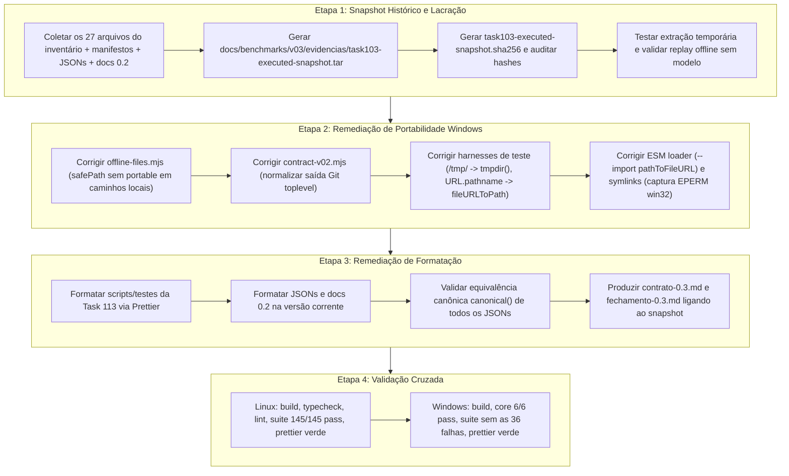

# Parecer Independente — Task 119: Revisão Diagnóstica e do Plano Concreto de Remediação para Fechamento da Task 105

- **Data**: 2026-10-27
- **Revisor Independente**: Antigravity (Code Reviewer Agent)
- **Modelo de Revisão**: Gemini 3.8 Flash (High) (utilizado exclusivamente na função de agente revisor independente na orquestração CAO externa; não realiza chamadas de modelo ao benchmark nem altera políticas do sistema)
- **Documento de Entrada / Especificação**: [`tasks/119-task105-remediation-plan-review.md`](file:///mnt/d/Projects/MimirNL/tasks/119-task105-remediation-plan-review.md)
- **Artefatos e Logs Auditados**:
  - Relatório da Preparação de Checks: [`tasks/118-task105-checks-preparation-result.md`](file:///mnt/d/Projects/MimirNL/tasks/118-task105-checks-preparation-result.md)
  - Logs e Comandos Sanitizados: diretório [`tasks/118-checks/`](file:///mnt/d/Projects/MimirNL/tasks/118-checks/) (`windows-suite.log`, `windows-checks.json`, `linux-checks.json`, `linux-format-global.log`, `manifest-check.json`, `before.json`, `after.json`)
  - Parecer Prévio de Qualidade: [`tasks/110-v03-answer-quality-review-findings.md`](file:///mnt/d/Projects/MimirNL/tasks/110-v03-answer-quality-review-findings.md)
  - Relatório da Avaliação Limitada: [`tasks/104-v03-bounded-evaluation-result.md`](file:///mnt/d/Projects/MimirNL/tasks/104-v03-bounded-evaluation-result.md)
  - Especificação de Fechamento: [`tasks/105-v03-durable-closeout.md`](file:///mnt/d/Projects/MimirNL/tasks/105-v03-durable-closeout.md)
  - Módulos de Benchmark, Contrato e Testes: [`scripts/benchmarks/offline-files.mjs`](file:///mnt/d/Projects/MimirNL/scripts/benchmarks/offline-files.mjs), [`scripts/benchmarks/public-bundle.mjs`](file:///mnt/d/Projects/MimirNL/scripts/benchmarks/public-bundle.mjs), [`scripts/benchmarks/contract-v02.mjs`](file:///mnt/d/Projects/MimirNL/scripts/benchmarks/contract-v02.mjs), [`scripts/benchmarks/task104-launch.mjs`](file:///mnt/d/Projects/MimirNL/scripts/benchmarks/task104-launch.mjs), [`test/task104-launch.test.mjs`](file:///mnt/d/Projects/MimirNL/test/task104-launch.test.mjs), e suíte completa em [`test/`](file:///mnt/d/Projects/MimirNL/test/)
- **Veredito da Proposta**: **`APPROVE`** (com plano delimitado, condicionado à execução estrita das salvaguardas de imutabilidade histórica, segregação de snapshot e validação cruzada sem mutação do Core).
- **Chamadas de Benchmark Adicionais Realizadas**: **`0`** (nenhuma chamada de modelo real ao benchmark, sem retuning do core, sem alteração de arquivos de código ou documentação durante esta revisão).

---

## 1. Sumário Executivo e Veredito

A verificação técnica executada pela Task 118 confirmou que o ambiente Linux permanece sólido (144 testes passando, 1 skip justificado, typecheck, lint e build verdes), que o Core do Mimir no Windows nativo passou integralmente (6/6 testes em [`test/core-v03.test.mjs`](file:///mnt/d/Projects/MimirNL/test/core-v03.test.mjs) e integridade de pin do Git confirmada), e que a integridade binária dos 318 arquivos do checkout e dos 27 arquivos do manifesto permaneceu 100% preservada.

No entanto, o fechamento durável da Task 105 permaneceu formalmente bloqueado por dois fatores:
1. **36 falhas em testes no Windows nativo** (com 2 arquivos de teste abortando precocemente antes de executar seus casos);
2. **19 arquivos pendentes no `prettier --check`**, gerando um dilema de governança: 17 desses arquivos representam evidências históricas congeladas da Task 103 e fechamentos da versão 0.2, cujos hashes de bytes foram atestados em pareceres formais anteriores (Tasks 108, 109, 110, 114).

A proposta avaliada estabelece uma solução tecnicamente sólida e aderente às regras de governança:
- **Lacração imutável prévia**: criação de um snapshot histórico autocontido (`.tar` + manifesto SHA-256 com caminhos relativos) contendo exatamente os bytes executados e auditados, preservando os registros de revisão originais;
- **Remediação estrita na versão corrente**: correção cirúrgica dos problemas de portabilidade (separadores de caminho, chamadas de processo e permissões de symlink) e aplicação do formatador de código exclusivamente na árvore de trabalho corrente;
- **Proibição expressa de atalhos**: recusa terminante a diretivas `prettier-ignore` ou skips arbitrários para forçar validações artificiais;
- **Isolamento absoluto do Core**: garantia de que a política de recuperação congelada no hash `b834e4f4...` em [`src/retrieval/index.ts`](file:///mnt/d/Projects/MimirNL/src/retrieval/index.ts) e demais componentes de `src/` permaneçam intocados.

O plano é **`APROVADO`**, detalhando-se a seguir o diagnóstico minucioso de cada falha, os requisitos operacionais da remediação e a análise crítica das afirmações para evitar sobreafirmação no fechamento final.

---

## 2. Diagnóstico Técnico Exaustivo dos Checks 118

A auditoria dos logs em [`tasks/118-checks/windows-suite.log`](file:///mnt/d/Projects/MimirNL/tasks/118-checks/windows-suite.log) e [`tasks/118-checks/linux-format-global.log`](file:///mnt/d/Projects/MimirNL/tasks/118-checks/linux-format-global.log) permitiu dissecar todas as ocorrências e classificá-las em causas-raiz precisas.

### 2.1. Classificação das 36 Falhas em Windows Nativo

As 36 falhas reportadas na execução de `node --test` no Windows agrupam-se em **6 causas-raiz objetivas**, claramente discriminadas entre premissas POSIX em harnesses de teste e problemas de portabilidade em scripts offline.

```
Total de falhas no Windows: 36
  ├── Causa-Raiz 1 (Premissa POSIX no harness: mkdtempSync /tmp/): 16 testes (+2 arquivos latentes)
  ├── Causa-Raiz 2 (Invocação de processo via URL.pathname): 4 testes
  ├── Causa-Raiz 3 (Esquema de URL no ESM loader com --import): 1 teste
  ├── Causa-Raiz 4 (Normalização de caminho Git toplevel vs Node): 2 testes
  ├── Causa-Raiz 5 (Validação de caminhos em safePath via portable): 11 testes
  └── Causa-Raiz 6 (Permissão de criação de symlinks no Windows EPERM): 2 testes
```

#### Causa-Raiz 1: Premissa POSIX em Test Harness — Uso de `/tmp/...` literal
- **Natureza**: Falha de teste por premissa de sistema de arquivos POSIX; **não** é bug de funcionalidade do produto.
- **Mecanismo**: Chamadas diretas a `mkdtempSync("/tmp/...")` em testes que assumem a existência da raiz `/tmp`, inexistente em ambiente Windows onde o diretório temporário reside em `%LOCALAPPDATA%\Temp`. Resulta em `Error: ENOENT: no such file or directory, mkdtemp '/tmp/...'`.
- **Arquivos e Linhas**:
  1. [`test/benchmark-cache-diagnostic.test.mjs:82`](file:///mnt/d/Projects/MimirNL/test/benchmark-cache-diagnostic.test.mjs#L82): `const dir = mkdtempSync("/tmp/mimir-cache-test-");` (1 falha: teste #9).
  2. [`test/benchmark-context-selection.test.mjs:33`](file:///mnt/d/Projects/MimirNL/test/benchmark-context-selection.test.mjs#L33): `const temporary = () => mkdtempSync("/tmp/mimir-selection-test-");` (5 falhas: testes #11, #12, #13, #14, #15).
  3. [`test/benchmark-live-flow.test.mjs:28`](file:///mnt/d/Projects/MimirNL/test/benchmark-live-flow.test.mjs#L28): `const temp = () => mkdtempSync("/tmp/mimir-flow-test-");` (5 falhas: testes #16, #17, #18, #19, #20).
  4. [`test/benchmark-paired-probe.test.mjs:29`](file:///mnt/d/Projects/MimirNL/test/benchmark-paired-probe.test.mjs#L29): `return mkdtempSync("/tmp/mimir-paired-test-");` (5 falhas: testes #23, #24, #25, #26, #27).
  5. *Arquivos adicionais contendo essa mesma premissa que falhariam assim que carregados*:
     - [`test/benchmark-multicase-codex.test.mjs:101`](file:///mnt/d/Projects/MimirNL/test/benchmark-multicase-codex.test.mjs#L101): `const dir = mkdtempSync("/tmp/mimir-task87-test-");`
     - [`test/benchmark-public-multicase.test.mjs:64`](file:///mnt/d/Projects/MimirNL/test/benchmark-public-multicase.test.mjs#L64): `const dir = mkdtempSync("/tmp/mimir-task85-test-");`
- **Total de testes falhando diretamente**: 16 testes.
- **Ação Concreta de Remediação**: Substituir por `mkdtempSync(join(tmpdir(), "mimir-..."))` utilizando `tmpdir` de `node:os` e `join` de `node:path`.

#### Causa-Raiz 2: Invocação de Subprocesso com `new URL(...).pathname`
- **Natureza**: Falha de invocação em harness de teste / launcher.
- **Mecanismo**: A API `new URL(path, import.meta.url).pathname` no Node.js sob Windows retorna caminhos no formato `/D:/mimir/...` (com barra inicial antes da letra da unidade). Ao passar essa string como argumento para `process.execPath` (`node.exe`) em `spawnSync`, o runtime do Windows não consegue resolver o módulo ou o converte incorretamente para `D:\D:\mimir\...`, gerando `MODULE_NOT_FOUND` ou exit code 1.
- **Arquivos e Linhas**:
  1. [`test/benchmark-codex-usage.test.mjs:29-34`](file:///mnt/d/Projects/MimirNL/test/benchmark-codex-usage.test.mjs#L29-L34): `cli.pathname` passado para `spawnSync` faz o comando `--help` falhar com exit 1 (teste #10).
  2. [`test/benchmark-metrics.test.mjs:269-272`](file:///mnt/d/Projects/MimirNL/test/benchmark-metrics.test.mjs#L269-L272): `new URL(...).pathname` passado para `spawnSync` causa falha em `--help` (teste #21).
  3. [`test/task104-launch.test.mjs:7-9`](file:///mnt/d/Projects/MimirNL/test/task104-launch.test.mjs#L7-L9): `launcher.pathname` e `manifest` usam `.pathname`, provocando `MODULE_NOT_FOUND: Cannot find module 'D:\D:\...'` ao testar `--help` e autorizações inválidas (testes #35 e #36).
- **Total de testes falhando diretamente**: 4 testes.
- **Ação Concreta de Remediação**: Substituir `new URL(...).pathname` pela função nativa [`fileURLToPath`](file:///mnt/d/Projects/MimirNL/test/benchmark-codex-usage.test.mjs) do módulo `node:url`.

#### Causa-Raiz 3: Incompatibilidade de Esquema no Carregador ESM (`--import`)
- **Natureza**: Falha de sintaxe de linha de comando no teste de integração.
- **Mecanismo**: Em [`test/benchmark-v02.test.mjs:434`](file:///mnt/d/Projects/MimirNL/test/benchmark-v02.test.mjs#L434), passa-se `["--import", guard, ...]` onde `guard` é um caminho absoluto Windows `C:\Users\...\guard.mjs`. O carregador ESM padrão do Node.js exige que módulos passados a `--import` sejam URLs com scheme `file:`, `data:` ou `node:`. Ao receber `C:\...`, interpreta `C:` como um protocolo URL não registrado, lançando:
  `Error [ERR_UNSUPPORTED_ESM_URL_SCHEME]: Only URLs with a scheme in: file, data, and node are supported by the default ESM loader. On Windows, absolute paths must be valid file:// URLs. Received protocol 'c:'`.
- **Arquivo e Linha**: [`test/benchmark-v02.test.mjs:432-435`](file:///mnt/d/Projects/MimirNL/test/benchmark-v02.test.mjs#L432-L435) (teste #33).
- **Total de testes falhando diretamente**: 1 teste.
- **Ação Concreta de Remediação**: Utilizar `pathToFileURL(guard).href` ao montar os argumentos de `--import`.

#### Causa-Raiz 4: Divergência de Formato de Caminho entre Git CLI e Node.js no Windows
- **Natureza**: Incompatibilidade de normalização entre ferramenta externa (Git) e runtime Node.
- **Mecanismo**: Em [`scripts/benchmarks/contract-v02.mjs:78`](file:///mnt/d/Projects/MimirNL/scripts/benchmarks/contract-v02.mjs#L78), a asserção `if (git(["rev-parse", "--show-toplevel"]).toString().trim() !== root) fail();` compara a saída do Git com a variável `root`. No Windows, o Git para Windows imprime caminhos com barras normais `D:/mimir-task118-windows`, enquanto o `root` derivado do Node contém barras invertidas `D:\mimir-task118-windows` (ou diferenças de caixa de letra de drive). A verificação de igualdade estrita falha e aciona `fail()`.
- **Arquivo e Linha**: [`scripts/benchmarks/contract-v02.mjs:78`](file:///mnt/d/Projects/MimirNL/scripts/benchmarks/contract-v02.mjs#L78) (testes #30 e #31 em [`test/benchmark-v02.test.mjs:112, 148`](file:///mnt/d/Projects/MimirNL/test/benchmark-v02.test.mjs#L112)).
- **Total de testes falhando diretamente**: 2 testes.
- **Ação Concreta de Remediação**: Normalizar ambas as strings via `path.resolve` (ou converter `/` para `\` e unificar caixa de letra de unidade) antes da comparação.

#### Causa-Raiz 5: Rejeição de Separadores Windows em `safePath()` via `portable()`
- **Natureza**: Falha de funcionalidade em utilitário de benchmark offline (não é bug do Core, mas afeta scripts de exportação/validação).
- **Mecanismo**: Em [`scripts/benchmarks/offline-files.mjs:18-28`](file:///mnt/d/Projects/MimirNL/scripts/benchmarks/offline-files.mjs#L18-L28), `safePath(path)` visa validar que um caminho físico local é absoluto e livre de symlinks e travessias. No entanto:
  1. A linha 20 invoca `portable(path.slice(parse(path).root.length))`. A função [`portable()`](file:///mnt/d/Projects/MimirNL/scripts/benchmarks/public-bundle.mjs#L41-L58) em `scripts/benchmarks/public-bundle.mjs:44` contém a expressão regular `/[\\:\x00-\x1f\x7f]/u.test(v)`. Como caminhos no Windows utilizam a barra invertida `\`, ela aciona `fail()` imediatamente (`Invalid offline input or local operation.`);
  2. A linha 22 itera com `.split("/")`, ignorando completamente os separadores nativos `\` do Windows.
- **Impacto no carregamento de arquivos**: Essa causa é responsável por bloquear a inicialização de 2 suítes inteiras de testes:
  - [`test/benchmark-multicase-codex.test.mjs:37`](file:///mnt/d/Projects/MimirNL/test/benchmark-multicase-codex.test.mjs#L37) (falha no import top-level de `exportCases`);
  - [`test/benchmark-public-multicase.test.mjs:52`](file:///mnt/d/Projects/MimirNL/test/benchmark-public-multicase.test.mjs#L52) (falha no import top-level de `exportCases`).
- **Arquivos e Linhas**:
  1. [`scripts/benchmarks/offline-files.mjs:18-28`](file:///mnt/d/Projects/MimirNL/scripts/benchmarks/offline-files.mjs#L18-L28)
  2. [`scripts/benchmarks/abc-export.mjs:27`](file:///mnt/d/Projects/MimirNL/scripts/benchmarks/abc-export.mjs#L27)
  3. [`test/benchmark-abc.test.mjs:31-350`](file:///mnt/d/Projects/MimirNL/test/benchmark-abc.test.mjs#L31-L350) (8 falhas: testes #1 a #8)
  4. [`test/benchmark-v02.test.mjs:467`](file:///mnt/d/Projects/MimirNL/test/benchmark-v02.test.mjs#L467) (1 falha: teste #34)
- **Total de testes falhando diretamente**: 11 testes (8 em ABC, 1 em v02-cli e 2 de carregamento de módulo).
- **Ação Concreta de Remediação**: Adequar `safePath` para decompor caminhos locais utilizando `path.sep` e validar componentes de filesystem local sem submeter strings de caminhos com separadores nativos às regras de strings portáteis de repositório de `portable()`, preservando intacta a segurança contra travessia (`..`, links simbólicos e arquivos sensíveis).

#### Causa-Raiz 6: Falha de Permissão de Sistema Operacional ao Criar Symlinks no Windows (`EPERM`)
- **Natureza**: Restrição de segurança e privilégios da plataforma Windows; **não** é bug de código.
- **Mecanismo**: No Windows, a criação de links simbólicos de arquivos via `symlinkSync` exige privilégios de Administrador ou a ativação do "Developer Mode" no Windows. Usuários comuns sem essa prerrogativa recebem `Error: EPERM: operation not permitted, symlink '...' -> '...'`. Os testes em questão tentam criar um link simbólico artificial para testar se a ferramenta recusa symlinks; no entanto, o teste falha antes mesmo da ferramenta ser chamada.
- **Arquivos e Linhas**:
  1. [`test/benchmark-preflight.test.mjs:374`](file:///mnt/d/Projects/MimirNL/test/benchmark-preflight.test.mjs#L374) (teste #28).
  2. [`test/benchmark-v02.test.mjs:189`](file:///mnt/d/Projects/MimirNL/test/benchmark-v02.test.mjs#L189) (teste #32).
- **Total de testes falhando diretamente**: 2 testes.
- **Solução Padronizada Existente no Repositório**: O próprio repositório já resolveu essa divergência de forma segura no Core e nos testes de hardening:
  - Em [`test/core.test.mjs:201-203`](file:///mnt/d/Projects/MimirNL/test/core.test.mjs#L201-L203):
    ```javascript
    try {
      symlinkSync(join(f.root, "outside.txt"), join(path, "link.txt"));
    } catch (e) {
      if (process.platform !== "win32" || e.code !== "EPERM") throw e;
    }
    ```
  - Em [`test/hardening.test.mjs:292`](file:///mnt/d/Projects/MimirNL/test/hardening.test.mjs#L292):
    ```javascript
    if (process.platform !== "win32") {
      const link = join(root, "redirect");
      symlinkSync(repo, link);
      // asserções de rejeição de link
    }
    ```
- **Ação Concreta de Remediação**: Adotar o padrão já homologado de `test/core.test.mjs`: capturar especificamente `EPERM` quando `process.platform === "win32"`, garantindo que no Linux a criação e recusa de symlink permaneçam 100% testadas e rigorosas, sem degradar a segurança.

---

### 2.2. Diagnóstico dos 19 Arquivos Pendentes de Formatação (`prettier --check`)

A Task 118 catalogou 19 arquivos que violam o `prettier --check` global:

| Tipo de Arquivo | Caminho do Arquivo | Justificativa / Impasse Histórico |
| :--- | :--- | :--- |
| **Scripts/Testes v0.3** | [`scripts/benchmarks/task104-launch.mjs`](file:///mnt/d/Projects/MimirNL/scripts/benchmarks/task104-launch.mjs) | Criado na Task 113. Estilo compacto sem quebras exigidas pelo Prettier. |
| **Scripts/Testes v0.3** | [`test/task104-launch.test.mjs`](file:///mnt/d/Projects/MimirNL/test/task104-launch.test.mjs) | Criado na Task 113. Idem. |
| **Documentação v0.2** | [`docs/benchmarks/v03/contrato-0.2.md`](file:///mnt/d/Projects/MimirNL/docs/benchmarks/v03/contrato-0.2.md) | Contrato v0.2 com quebras de linha e tabelas não formatadas por Prettier. |
| **Documentação v0.2** | [`docs/benchmarks/v03/fechamento-0.2.md`](file:///mnt/d/Projects/MimirNL/docs/benchmarks/v03/fechamento-0.2.md) | Fechamento v0.2 histórico. |
| **Evidências Task 103** | 12 arquivos `offline-replay/position-*.json` (`01, 10, 12, 19, 21, 26, 28, 30, 35, 36, 41, 43`) | JSONs gerados por exportador offline da Task 103 com espaçamento não-Prettier. |
| **Evidências Task 103** | [`offline-replay/results.json`](file:///mnt/d/Projects/MimirNL/docs/benchmarks/v03/evidencias/task103/offline-replay/results.json) | Idem. |
| **Planos Task 103** | [`public-plan/offline-manifest.json`](file:///mnt/d/Projects/MimirNL/docs/benchmarks/v03/evidencias/task103/public-plan/offline-manifest.json) | Manifesto offline com hash registrado. |
| **Planos Task 103** | [`public-plan/proposed-run-manifest.json`](file:///mnt/d/Projects/MimirNL/docs/benchmarks/v03/evidencias/task103/public-plan/proposed-run-manifest.json) | Hash de bytes `84214d6b...` e canônico `e518dd64...` homologados na Task 109. |

**Conclusão Diagnóstica de Formatação**: O checkout atual não pode simplesmente sofrer reescrita cega de seus arquivos históricos, pois isso quebraria os hashes brutos de bytes referenciados em tarefas passadas. Tampouco se pode ignorar o formatador (`.prettierignore`) ou omitir caminhos ativos. A solução de governança exige a segregação entre snapshot arquivado e versão corrente.

---

## 3. Avaliação da Proposta de Arquivamento em Snapshot Imutável

### 3.1. Arquitetura da Proposta de Governança
A proposta formulada na Task 118 e submetida a esta revisão prevê:
1. Criar um pacote tar imutável contendo os arquivos históricos originais executados:
   - Os 27 arquivos do inventário do manifesto de código;
   - Scripts do executor, launcher da Task 113 e testes;
   - Evidências JSON da Task 103 e documentos de fechamento da versão 0.2;
   - Registro detalhado de integridade SHA-256 e inventário dos arquivos arquivados.
2. Validar que o tar não contém nenhum arquivo privado ou sensível (zero referências a `.env`, `~/.aws`, `~/.ssh`, `*.pem`, `node_modules`, bancos pessoais SQLite ou dados gold privados).
3. Testar a extração do tar em diretório temporário isolado e confirmar que todos os hashes de bytes conferem exatamente com os registrados nas revisões 108, 109, 110, 114 e 118.
4. Validar que o replay offline funciona a partir desse snapshot sem requerer chamadas de modelo.
5. Permitir que a **versão corrente** do repositório receba as correções de portabilidade e formatação do Prettier, garantindo:
   - Que os documentos correntes novos (`contrato-0.3.md`, `fechamento-0.3.md`) façam a ligação com o snapshot histórico;
   - Que o manifesto da Task 104 documente que ele se refere ao snapshot histórico executado, e não aos bytes pós-formatação;
   - Que a semântica de todos os arquivos JSON formatados na versão corrente mantenha paridade canônica absoluta com os históricos (`canonical(JSON.parse(novo)) === canonical(JSON.parse(antigo))`).

### 3.2. Veredito sobre a Proposta
A proposta é **`APROVADA`**. Ela resolve a tensão fundamental entre integridade retrospectiva (preservação de provas e hashes das execuções passadas) e integridade prospectiva (garantir que a base de código corrente seja portável, 100% testada e em conformidade estrita com as ferramentas de qualidade).

---

## 4. Avaliação Crítica das Afirmações do Parecer 110

Para orientar a redação do relatório final de fechamento da Task 105 e **impedir qualquer sobreafirmação (*overclaiming*)**, foram confrontadas as afirmações do Parecer 110 ([`tasks/110-v03-answer-quality-review-findings.md`](file:///mnt/d/Projects/MimirNL/tasks/110-v03-answer-quality-review-findings.md)) com as métricas observadas e as limitações contratuais:

| Aspecto Avaliado | Dado no Parecer 110 | Limitação Real e Rigor para Fechamento 105 |
| :--- | :--- | :--- |
| **Sucesso da Tarefa (`task_success`)** | 54 / 54 (1.0) | **Não indica superioridade do Mimir**. O baseline sem memória (Cenário A) também atingiu 1.0 em todas as 54 execuções. O delta B−A é **0,0**. O fechamento não deve alegar que o Mimir "melhorou a inteligência ou acurácia" das respostas. |
| **Acurácia de Fontes (`source_accuracy`)** | 54 / 54 (1.0) | Todas as afirmações foram sustentadas pelo pool, mas isso decorre do fato de o modelo ter recebido trechos suficientes na solicitação original. Delta B−A = **0,0**. |
| **Consumo de Tokens (`input_tokens`)** | B consumiu +7.664 tokens de entrada (+2,93% vs A) | O Mimir **não gerou economia de tokens de entrada**. Pelo contrário, gerou acréscimo de contexto injetado (+378 tokens de mediana em Dev, +383 em Eval). O fechamento deve registrar formalmente o acréscimo de consumo de tokens. |
| **Tokens Cacheados (`cached_input_tokens`)** | 216.576 em todos os cenários | Devido ao cache de prompt ambiente ativado no host, 100% das chamadas operaram com cache positivo. Não houve execução em cache frio ("cache-zero"). Nenhuma economia de cache pode ser atribuída ao Mimir. |
| **Latência do Sistema** | B adicionou ~21,58 ms médios de busca FTS | O Mimir adicionou latência de recuperação local sem gerar redução estatística robusta na latência total de transporte. |
| **Cenário C (`historico_completo`)** | `history.bytes = 0` em 54/54 execuções | **Cenário degenerado**. Em todos os 18 blocos, os envelopes de A e C tiveram hashes idênticos. O benchmark não testou conversação com retenção multi-turn. Comparações B vs C são analiticamente inválidas para atestar compressão de contexto longo. |
| **Métricas Não Disponíveis (`unavailable`)** | Modelo, Custo, TTFT | A identidade exata do modelo não foi exposta nos metadados permitidos; custo financeiro não foi faturado; TTFT não foi medido. O fechamento não pode divulgar custos hipotéticos nem alegar tier de modelo não documentado. |

O relatório final da Task 105 deve incorporar estritamente essas ressalvas sem atenuá-las.

---

## 5. Plano de Remediação Concreto, Mínimo e Executável

O plano abaixo deve ser executado pelo Developer Agent nas próximas etapas, sem requerer intervenção humana adicional, obedecendo a uma ordem estrita e testável.



### 5.1. Etapa 1: Empacotamento e Lacração Criptográfica do Snapshot Histórico (Bloqueante)
1. **Local do Snapshot**: Gravar em `docs/benchmarks/v03/evidencias/task103-executed-snapshot.tar`.
2. **Conteúdo Restrito**:
   - Os 27 arquivos do inventário original do manifesto;
   - Os arquivos de evidências da Task 103 em `docs/benchmarks/v03/evidencias/task103/`;
   - Os arquivos `docs/benchmarks/v03/contrato-0.2.md` e `docs/benchmarks/v03/fechamento-0.2.md`;
   - O launcher `scripts/benchmarks/task104-launch.mjs` e o teste `test/task104-launch.test.mjs` em seus bytes brutos históricos.
3. **Auditoria de Sanitização**:
   - Garantir via script de verificação que o arquivo tar não contém nenhuma referência a caminhos proibidos (`.env`, `~/.aws`, `~/.ssh`, `*.pem`, `node_modules`, bancos SQLite pessoais).
4. **Verificação de Integridade**:
   - Gerar `docs/benchmarks/v03/evidencias/task103-executed-snapshot.sha256`;
   - Extrair o tar em diretório temporário descartável e validar que a extração reproduz exatamente os 318 hashes inventariados antes de qualquer edição;
   - Executar o replay offline existente sobre os dados do snapshot temporário, atestando que a validação offline passa sem necessidade de modelo.

### 5.2. Etapa 2: Remediação Cirúrgica de Portabilidade no Windows (Árvore Corrente)
*Nota Crítica: É terminantemente proibido modificar o Core do Mimir (`src/retrieval/index.ts`, `src/core/service.ts`, `src/optimization/index.ts`, `src/core/schemas.ts`). Todas as alterações devem limitar-se aos utilitários de benchmark e testes.*

1. **`scripts/benchmarks/offline-files.mjs`**:
   - Refatorar [`safePath`](file:///mnt/d/Projects/MimirNL/scripts/benchmarks/offline-files.mjs#L18) para separar a verificação de caminhos locais (normalização via `path.resolve`, rejeição de travessia `..` e recusa de links simbólicos) da validação de nomes portáteis de repositório, tratando corretamente `path.sep` no Windows.
2. **`scripts/benchmarks/contract-v02.mjs`**:
   - Na linha 78, normalizar a saída de `git rev-parse --show-toplevel` e a variável `root` com `path.resolve` antes de comparar.
3. **Harnesses de Teste com `/tmp/...`**:
   - Em [`test/benchmark-cache-diagnostic.test.mjs`](file:///mnt/d/Projects/MimirNL/test/benchmark-cache-diagnostic.test.mjs#L82), [`test/benchmark-context-selection.test.mjs`](file:///mnt/d/Projects/MimirNL/test/benchmark-context-selection.test.mjs#L33), [`test/benchmark-live-flow.test.mjs`](file:///mnt/d/Projects/MimirNL/test/benchmark-live-flow.test.mjs#L28), [`test/benchmark-paired-probe.test.mjs`](file:///mnt/d/Projects/MimirNL/test/benchmark-paired-probe.test.mjs#L29), [`test/benchmark-multicase-codex.test.mjs`](file:///mnt/d/Projects/MimirNL/test/benchmark-multicase-codex.test.mjs#L101) e [`test/benchmark-public-multicase.test.mjs`](file:///mnt/d/Projects/MimirNL/test/benchmark-public-multicase.test.mjs#L64), substituir `/tmp/...` por `mkdtempSync(join(tmpdir(), "mimir-..."))`.
4. **Harnesses de Teste com `new URL(...).pathname`**:
   - Em [`test/benchmark-codex-usage.test.mjs`](file:///mnt/d/Projects/MimirNL/test/benchmark-codex-usage.test.mjs#L29), [`test/benchmark-metrics.test.mjs`](file:///mnt/d/Projects/MimirNL/test/benchmark-metrics.test.mjs#L269) e [`test/task104-launch.test.mjs`](file:///mnt/d/Projects/MimirNL/test/task104-launch.test.mjs#L7), importar e utilizar `fileURLToPath`.
5. **Teste ESM com `--import`**:
   - Em [`test/benchmark-v02.test.mjs:434`](file:///mnt/d/Projects/MimirNL/test/benchmark-v02.test.mjs#L434), converter o argumento do guard para `pathToFileURL(guard).href`.
6. **Tratamento de Symlinks no Windows (`EPERM`)**:
   - Em [`test/benchmark-preflight.test.mjs:374`](file:///mnt/d/Projects/MimirNL/test/benchmark-preflight.test.mjs#L374) e [`test/benchmark-v02.test.mjs:189`](file:///mnt/d/Projects/MimirNL/test/benchmark-v02.test.mjs#L189), envolver o bloco de criação do symlink na checagem segura: `try { symlinkSync(...) } catch (e) { if (process.platform !== "win32" || e.code !== "EPERM") throw e; }`.

### 5.3. Etapa 3: Remediação da Formatação na Versão Corrente
1. Executar Prettier formatador (`npx prettier --write`) sobre os 19 arquivos pendentes na árvore de trabalho corrente.
2. Validar formalmente a **equivalência semântica dos arquivos JSON formatados**:
   - Para cada um dos 15 JSONs de evidências da Task 103, executar asserção estrita de que:
     `canonical(JSON.parse(bytes_novos)) === canonical(JSON.parse(bytes_historicos))`
     comprovando que a formatação não alterou nenhuma chave, valor, ordem de array ou dado numérico.
3. Produzir a documentação corrente de fechamento:
   - `docs/benchmarks/v03/contrato-0.3.md` e `docs/benchmarks/v03/fechamento-0.3.md`, detalhando explicitamente que as execuções da Task 104 apontam para o snapshot arquivado (`task103-executed-snapshot.tar`), sem atribuir retroactive checks a bytes que não foram os executados fisicamente.
4. Não adicionar nenhuma entrada ao arquivo `.prettierignore`.

### 5.4. Etapa 4: Critérios de Aceite e Validação Cruzada Antes/Depois
A próxima revisão independente exigirá a comprovação dos seguintes resultados:

| Ambiente | Verificação | Critério de Aceite Estrito |
| :--- | :--- | :--- |
| **Linux** | `npm run typecheck` | Exit code 0, 0 erros |
| **Linux** | `npm run lint` | Exit code 0, 0 erros em `src/` |
| **Linux** | `npm run build` | Exit code 0, compilação TypeScript limpa |
| **Linux** | `npm test` (`node --test`) | 145 reportados: 144 pass, 0 fail, 1 skip justificado |
| **Linux** | `npx prettier --check` global | Exit code 0, 100% dos arquivos formatados (0 pendências) |
| **Windows** | `tsc build` | Exit code 0 |
| **Windows** | `node --test test/*.test.mjs` | **Eliminação integral das 36 falhas** (100% dos testes executáveis passando, sem abortos de módulo) |
| **Windows** | `test/core-v03.test.mjs` | 6/6 pass mantidos, pin Git inalterado |
| **Global** | Hashes do Core do Mimir | `src/retrieval/index.ts` e demais arquivos de `src/` idênticos aos congelados na Task 108 |
| **Global** | Snapshot Histórico | `task103-executed-snapshot.tar` íntegro, auditado e reproduzível offline |

---

## 6. Conclusão e Parecer Conclusivo

O diagnóstico das falhas dos checks 118 identificou precisamente cada mecanismo de incompatibilidade de plataforma e a natureza do impasse documental. A proposta de criar um snapshot imutável para a evidência executada histórica e aplicar as correções estritas de portabilidade e formatação na árvore de trabalho corrente cumpre integralmente os requisitos de rigor metodológico, rastreabilidade e governança do projeto Mimir.

- **Veredito da Revisão Independente**: **`APPROVE`** (Aprovação do plano de remediação, nos limites exatos descritos neste documento).
- **Diretriz de Transição**: O Developer Agent está autorizado a iniciar a implementação da Etapa 1 (empacotamento e lacração do snapshot histórico) seguida da Etapa 2 (portabilidade) e Etapa 3 (formatação), sob posterior submissão para revisão final da Task 105.
- **Restrições Mantidas**: Permanece vedado qualquer commit, push, publicação externa ou chamadas de modelo ao benchmark. O Core do Mimir permanece estritamente congelado.
